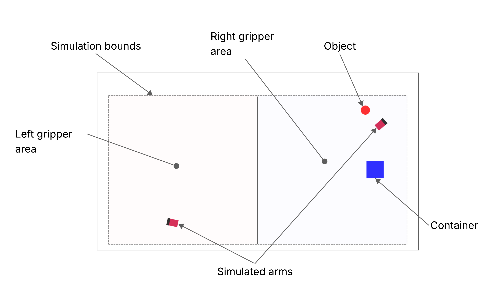

# Manipulation 2D Experiment

This experiment uses a 2D environment that simulates, a dual-armed manipulator. 

The task consists in placing an object in a box. These elements are placed in random positions. The robot is controlled by low-level incremental movements.


<div style="width:100%; margin:auto; text-align:center;">



*Simulated 2D environment*
</div>

## Experiment description

This experiment showcases the model learning capabilities of the architecture. Its use of low-level actions enables the autonomous learning of World and Utility Models. 

The perceptions received by the cognitive architecture are the following ones:

- **Ball angle**: horizontal (x) position of the ball relative to the center of the environment.
- **Box angle**: horizontal (x) position of the box relative to the center of the environment.
- **Distance ball, box**: data about the distance between the ball and the box.
    - **Distance**: distance between the ball and the box.
    - **Angle**: relative angle between the objects. Decomposed into sin and cos components.
- **Distance left arm, ball**: data about the distance between the left arm and the ball.
    - **Distance**: distance between the left arm and the ball.
    - **Angle**: relative angle between the orientation of the manipulator and the ball. Decomposed into sin and cos components.
- **Distance right arm, ball**: data about the distance between the right arm and the ball.
    - **Distance**: distance between the right arm and the ball.
    - **Angle**: relative angle between the orientation of the manipulator and the ball. Decomposed into sin and cos components.


The action vector has the following components:

- **Left arm**: commands to the left arm.
    - **Distance**: forward displacement of the actuator.
    - **Angle**: relative angular displacement of the orientation of the manipulator.
- **Right arm**: commands to the right arm.
    - **Distance**: forward displacement of the actuator.
    - **Angle**: relative angular displacement of the orientation of the manipulator. 

The robot executes these commands through the executed action service (`executed_action_service` in the experiment file): the cognitive architecture sends the low-level action, as a Container, to the simulator bridge, which applies it to both arms and updates the grippers.

## Execution

This experiment uses `MainLoopLight` as its main loop, a version of `MainLoop` that only performs the selection and execution of policies and utility models. The experiment is launched using the following command:

```bash
ros2 launch experiments sim2D_launch.py visualize:=True
```

This experiment is configured through the [sim_2d_experiment.yaml](https://github.com/pillar-robots/emdb_experiments_gii/blob/main/experiments/experiments/sim_2d_experiment.yaml) file, which you can find in the *experiments* package of this repository. The parameters that can be set in this file are described in the [configuration page](https://docs.pillar-robots.eu/projects/emdb_core/en/latest/core/configuration.html) of the core documentation.

Once executed, it is possible to see the logs in the terminal, being able to follow the behavior of the experiment in real time.


