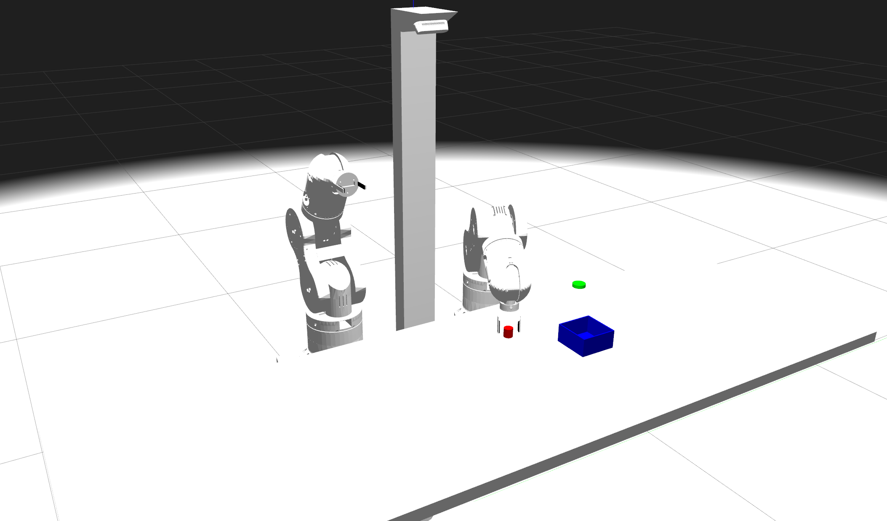
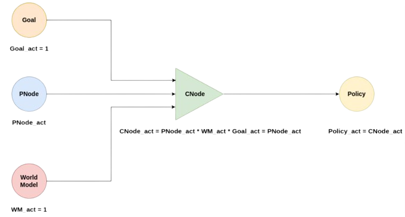

# OSCAR Experiment

This experiment is the [PutObjectInBox experiment](put_object_in_box_experiment.md) implemented in the OSCAR robot in the Gazebo simulator. 

Remembering, the task consists in placing a cylinder in a box. These elements are placed in random positions and may be out of reach of the robot.

<div style="width:100%; margin:auto; text-align:center;">



*OSCAR robot*
</div>

## Experiment description

As in the PutObjectInBox experiment, this experiment tests the behavior of the Long-Term Memory (LTM) and of the motivational system of the architecture. There is a single World Model (GRIPPER_AND_LOW_FRICTION). The motivational system has the Mission *ball_in_box_mission* (placing the cylinder in the box) and four Needs: *novelty*, *effectance* (internal), *external effects* and *prospection*, each one with its Drive, Goal, P-Node, C-Node and Policy, as described in the [PutObjectInBox experiment](put_object_in_box_experiment.md). The Goal of the Mission is not defined in the configuration file: it is created and learned during the execution.

The perceptions received by the cognitive architecture are the following ones:

- **Boxes**: data about the boxes in the table.
    - **Distance**: distance from the robot to the box.
    - **Angle**: angle from the robot to the box.
    - **Diameter**: diameter of the box (a constant value, it is not measured).

- **Cylinders**: data about the cylinders in the table.
    - **Distance**: distance from the robot to the cylinder.
    - **Angle**: angle from the robot to the cylinder.
    - **Diameter**: diameter of the cylinder (a constant value, it is not measured).
- **Object in left hand**: indicates if the robot has the cylinder in the left gripper.
- **Object in right hand**: indicates if the robot has the cylinder in the right gripper.

The policies that the robot can use to solve the task are the following ones. The first six are executed by the OSCAR server:

- **Grasp right / Grasp left:** Use the right or the left arm to grasp the object, if it is reachable.
- **Change hands:** Move the object from one gripper to the other.
- **Press button:** Press the button with the left arm. If the object is out of reach, it is moved closer to the robot.
- **Place object right / Place object left:** Place the object in the box with the right or the left arm, if the arm holds the object and the box is within reach.

The remaining four policies belong to the motivational system, one per Need: *novelty_policy*, *effectance_policy*, *external_effect_policy* and *prospection_policy*.

The reward of the Mission is binary: the *ball_in_box_goal* sensor is 1.0 if the cylinder is in the box and 0.0 otherwise. The partial rewards defined in the OSCAR server (approaching the object with the button, grasping it and switching hands) are not used.

P-Nodes and C-Nodes are created as rewards are obtained, linking the Policies that lead to the Mission with the situations in which they work.

We will have this structure for each Policy:

<div style="width:100%; margin:auto; text-align:center;">



*Contextual structure*
</div>

So, as we can see, the Policies activation depends exclusively on their P-Nodes activation. Thus, during the experiment, points and anti-points will be added to the P-Nodes each time a Policy is executed, improving the calculation of activations and, in consequence, the decision-making of the cognitive architecture.

## Execution

To execute this experiment, the OSCAR simulator must be installed. The instructions can be found [here](https://github.com/efallash/oscar/tree/humble_gazebo_classic), in its branch for ROS 2 Humble and Gazebo Classic, the most recent one.

Once installed, to run the experiment, first the OSCAR simulator must be launched:

```bash
ros2 launch oscar_bringup oscar_table_launch.py
```

Afterwards, the experiment can be launched:

```bash
ros2 launch experiments oscar_launch.py
```

This experiment is configured through the **oscar_experiment.yaml** file, which you can find in the *experiments* package of this repository. The parameters that can be set in this file are described in the [configuration page](https://docs.pillar-robots.eu/projects/emdb_core/en/latest/core/configuration.html) of the core documentation.

Once executed, it is possible to see the logs in the terminal, being able to follow the behavior of the experiment in real time.

<!-- ## Results

Executing the example experiment, it will create two files by default: **goodness.txt** and **pnodes_success.txt**.

In the first one, it is possible to observe important information, such as the policy executed and the reward obtained per iteration. It is possible to observe the learning process by seeing this file in real time with the following command:

```bash
tail -f goodness.txt
```

| Iteration | World                     | Goal reward list    | Policy                | Sensorial changes | C-nodes |
|-----------|---------------------------|---------------------|-----------------------|-------------------|---------|
| 1415      | GRIPPER_AND_LOW_FRICTION  | {'goal_0': '0.0'}   | press_button          | True              | 6       |
| 1416      | GRIPPER_AND_LOW_FRICTION  | {'goal_0': '0.0'}   | grasp_right           | True              | 6       |
| 1417      | GRIPPER_AND_LOW_FRICTION  | {'goal_0': '1.0'}   | place_object_right    | True              | 6       |

In the second file, it's possible to see an activation historical of the P-Nodes and if it was a point (True) or an anti-point (False).

When the execution is finished, it's possible to obtain statistics about reward and P-Nodes activations per 100 iterations by using the scripts available in the scripts directory of the core package (the *core/scripts* directory of the emdb_core repository):

```bash
python3 <path_to_emdb_core>/core/scripts/generate_grouped_statistics -n 100 -f goodness.txt > goodness_grouped_statistics.csv

python3 <path_to_emdb_core>/core/scripts/generate_grouped_success_statistics -n 100 -f pnodes_success.txt > pnodes_grouped_statistics.csv
```

```{note}
To use these scripts it's necessary to have installed the **python-magic 0.4.27**, **pandas**, **matplotlib** and **numpy** dependencies.
```

By plotting the data of these final files, it is possible to obtain a visual interpretation of the learning of the cognitive architecture.  -->

## OSCAR Alignment Experiment

This experiment is a new version of the [PutObjectInBox experiment](put_object_in_box_experiment.md) implemented in the OSCAR robot in the Gazebo simulator. 
In this case, the experiment uses an Alignment Engine powered by an LLM model. The LLM receives the human purpose in natural language and it is trained to interact with the human until the purpose is fully defined. Then, this purpose goes to the Translation Engine, which is composed by two LLM models and transforms the purpose into missions and drive functions compatible with the e-MDB cognitive architecture. In this case, the purpose of the user is to place the red object in a box. These elements are placed in random positions and may be out of reach of the robot.

### Experiment description

This experiment was designed to validate the Alignment Engine and the validity of the missions and drives generated by the Translation Engine. There is only one World Model (GRIPPER_AND_LOW_FRICTION) and the user can express the purpose in different ways but in the end the robot should be able to reach the goal every time.

Unlike the previous experiment, no Mission is defined in the configuration file. The motivational system has five Needs: *alignment*, whose Drive is always active and whose Policy (*alignment_policy*) runs the interaction with the user and creates the Missions and Drives from the resulting purpose, and the *novelty*, *effectance* (internal), *external effects* and *prospection* Needs, as in the previous experiment.

The perceptions received by the cognitive architecture are the following ones:

- **Robot_hand**: data about the robot's hand position in the table.
    - **X Position**: x position of the robot's right hand.
    - **Y Position**: y position of the robot's right hand.
    - **State**: indicates the state of the gripper.

- **Object_1**: data about the cylinder in the table.
    - **X Position**: x position of the cylinder.
    - **Y Position**: y position of the cylinder.
    - **Color**: indicates the color of the cylinder.
    - **Diameter**: cylinder diameter value.

- **Object_2**: data about the blue box in the table.
    - **X Position**: x position of the box.
    - **Y Position**: y position of the box.
    - **Color**: indicates the color of the box.
    - **Diameter**: box diameter value.

The policies that the robot can use to solve the task are the following ones:

- **Grasp right:** Use the right arm and gripper to grasp an object.
- **Press button:** Press the button with the left arm. If the object is out of reach, it is moved closer to the robot.
- **Place object right:** Place an object in the box with the right arm.
- **Alignment policy**, plus the *novelty*, *effectance*, *external effect* and *prospection* policies of the motivational system.

### Execution

To execute this experiment, the OSCAR simulator must be installed. The instructions can be found [here](https://github.com/efallash/oscar/tree/humble_gazebo_classic), in its branch for ROS 2 Humble and Gazebo Classic, the most recent one.

Once installed, to run the experiment, first the OSCAR simulator must be launched:

```bash
ros2 launch oscar_bringup oscar_table_launch.py
```

Afterwards, the experiment can be launched:

```bash
ros2 launch experiments oscar_alignment_launch.py
```

This experiment is configured through the **oscar_alignment_experiment.yaml** file, which you can find in the *experiments* package of this repository. The parameters that can be set in this file are described in the [configuration page](https://docs.pillar-robots.eu/projects/emdb_core/en/latest/core/configuration.html) of the core documentation.

Once executed, it is possible to see the logs in the terminal, being able to follow the behavior of the experiment in real time.

In the first experiment iteration a window with a chatbox opens, where the user writes the purpose and interacts with the engine.

Then, the experiment is executed as normal.
