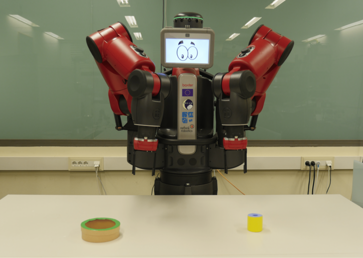
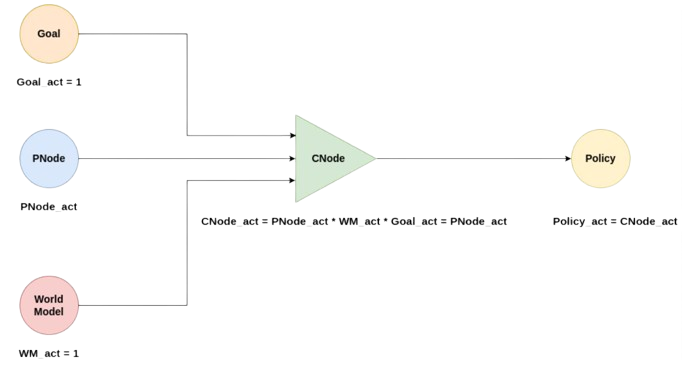

# PutObjectInBox Experiment

This experiment uses a Discrete Event Simulator that simulates, without physics, the Baxter robot, which has two arms. 

The task consists in placing a cylinder in a box. These elements are placed in random positions and may be out of reach of the robot.


<div style="width:100%; margin:auto; text-align:center;">



*Baxter robot*
</div>

## Experiment description

This experiment tests the behavior of the Long-Term Memory (LTM) and of the motivational system of the architecture. The Policies, the motivational nodes (Missions, Needs and Drives), the Goals and Cognitive Nodes of the Needs, and the World Model are defined at the beginning. The objective is to create the corresponding P-Nodes and C-Nodes, which allow the simulated robot to achieve the Mission effectively, choosing the correct Policy in each situation.

The motivational system is composed of:

- **Mission**: *object_in_box_mission*, which consists in introducing a cylinder into a box. Its Drive (*object_in_box_drive*) is satisfied when the simulator reports that the cylinder is in the box. The Goal that represents this Mission is not defined in the configuration file: it is created and learned during the execution.
- **Needs**: *novelty*, *effectance* (internal), *external effects* and *prospection*. Each Need has its own Drive, Goal, P-Node, C-Node and Policy (see the [intrinsic motivations](https://docs.pillar-robots.eu/en/latest/concepts/concepts.html#intrinsic-motivations) in the documentation of the cognitive nodes).

The World Model node, called GRIPPER_AND_LOW_FRICTION, defines the behavior of the simulator, but it hasn't effect on the operation of the cognitive architecture, because it 
acts as a dummy node that always has 1.0 activation. That is, changing the WorldModel affects the behavior of the simulated environment and, therefore, the effect of the policies in it, but without a direct influence on the cognitive architecture.

The reward of the Mission comes from the *ball_in_box_goal* sensor of the simulator, which is binary: 1.0 if the cylinder is in the box, and 0.0 otherwise. The *put_object_in_box_rewards.yaml* file uses instead the *progress_ball_in_box* sensor, which also gives partial rewards (0.2, 0.3 or 0.6, depending on how close the robot is to putting the cylinder in the box) and 1.0 when the cylinder is in the box.

The perceptions received by the cognitive architecture are the following ones:

- **Boxes**: data about the boxes in the table.
    - **Distance**: distance from the robot to the box.
    - **Angle**: angle from the robot to the box.
    - **Diameter**: diameter of the box.

- **Cylinders**: data about the cylinders in the table.
    - **Distance**: distance from the robot to the cylinder.
    - **Angle**: angle from the robot to the cylinder.
    - **Diameter**: diameter of the cylinder.
- **Ball in left hand**: indicates if the robot has the cylinder in the left gripper.
- **Ball in right hand**: indicates if the robot has the cylinder in the right gripper.

The policies that the robot can use to solve the task are the following ones. The first eight are executed by the simulator:

- **Grasp object:** Use one of the two grippers to grasp an object.
- **Grasp object with two hands:** Use both arms to grasp an object between their ends.
- **Change hands:** Move an object from one gripper to the other.
- **Sweep object:** Sweep an object to the central line of the table.
- **Ask nicely:** Ask experimenter, simulated in this case, to bring something to within reach.
- **Put object with robot:** Deposit an object close to the robot base.
- **Put object in box:** Place an object in a receptacle.
- **Throw:** Throw an object to a position.

The remaining four policies belong to the motivational system, one per Need: *novelty_policy* (executes a policy selected at random), *effectance_policy* (creates a Goal that aims to reach a consolidated P-Node), *external_effect_policy* (creates a Goal that aims to recreate an effect in the environment) and *prospection_policy* (links Goals to P-Nodes based on the knowledge already learned).

During the execution of the experiment, P-Nodes and C-Nodes are created as rewards are obtained, linking the Policies that lead to the Mission with the situations in which they work.

We will have this structure for each Policy:

<div style="width:100%; margin:auto; text-align:center;">



*Contextual structure*
</div>

So, as we can see, the Policies activation depends exclusively on their P-Nodes activation. Thus, during the experiment, points and anti-points will be added to the P-Nodes each time a Policy is executed, improving the calculation of activations and, in consequence, the decision-making of the cognitive architecture.

## Execution

The experiment is launched using the following command:

```bash
ros2 launch experiments put_object_in_box_launch.py
```

This experiment is configured through the [put_object_in_box_experiment.yaml](https://github.com/pillar-robots/emdb_experiments_gii/blob/main/experiments/experiments/put_object_in_box_experiment.yaml) file, which you can find in the *experiments* package of this repository. The parameters that can be set in these files are described in the [configuration page](https://docs.pillar-robots.eu/projects/emdb_core/en/latest/core/configuration.html) of the core documentation.

The *experiments* package also includes variants of this file: *put_object_in_box_rewards.yaml* (partial rewards, and only the novelty Need), and *put_object_in_box_ext_eff.yaml* and *put_object_in_box_int_eff.yaml* (only the external or the internal effectance Need, respectively, besides the novelty one).

Once executed, it is possible to see the logs in the terminal, being able to follow the behavior of the experiment in real time.

<!-- ## Results

Executing the example experiment, it will create two files by default: **goodness.txt** and **pnodes_success.txt**.

In the first one, it is possible to observe important information, such as the policy executed and the reward obtained per iteration. It is possible to observe the learning process by seeing this file in real time with the following command:

```bash
tail -f goodness.txt
```

| Iteration | World                     | Goal reward list    | Policy                | Sensorial changes | C-nodes |
|-----------|---------------------------|---------------------|-----------------------|-------------------|---------|
| 1416      | GRIPPER_AND_LOW_FRICTION  | {'goal_0': '0.0'}   | sweep_object          | True              | 7       |
| 1417      | GRIPPER_AND_LOW_FRICTION  | {'goal_0': '0.0'}   | grasp_with_two_hands  | True              | 7       |
| 1418      | GRIPPER_AND_LOW_FRICTION  | {'goal_0': '1.0'}   | put_object_in_box     | True              | 7       |

In the second file, it's possible to see an activation historical of the P-Nodes and if it was a point (True) or an anti-point (False).

When the execution is finished, it's possible to obtain statistics about reward and P-Nodes activations per 100 iterations by using the scripts available in the scripts directory of the core package (the *core/scripts* directory of the emdb_core repository):

```bash
python3 <path_to_emdb_core>/core/scripts/generate_grouped_statistics -n 100 -f goodness.txt > goodness_grouped_statistics.csv

python3 <path_to_emdb_core>/core/scripts/generate_grouped_success_statistics -n 100 -f pnodes_success.txt > pnodes_grouped_statistics.csv
```

```{note}
To use these scripts it's necessary to have installed the **python-magic 0.4.27**, **pandas**, **matplotlib** and **numpy** dependencies.
```

By plotting the data of these final files, it is possible to obtain a visual interpretation of the learning of the cognitive architecture. -->
