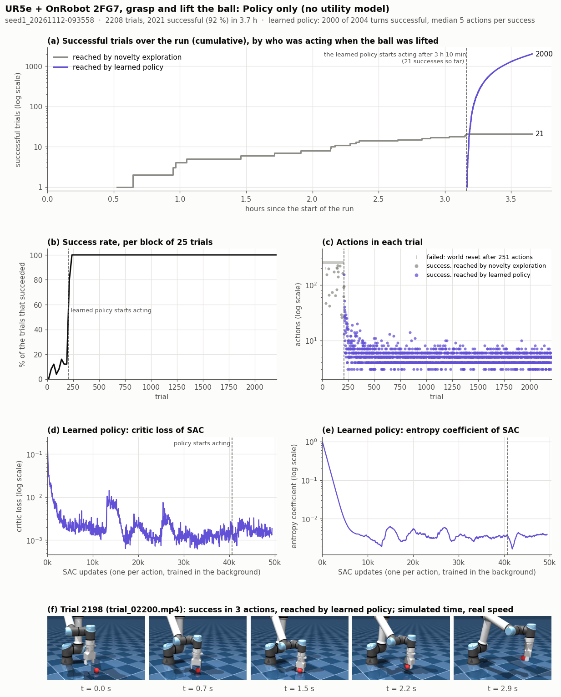

# UR5e Grasp and Lift Experiment

In this experiment a UR5e arm with an OnRobot 2FG7 gripper has to grasp a ball and lift it 5 cm, with low-level actions and no grasp macro. It is simulated in MuJoCo: the `sim_ur5` executable of the *ur5_mujoco_emdb* package of this repository, started by the launch file, runs the UR5e simulation of the *ur5_mujoco* package (in the `physics_simulators` folder of [emdb_discrete_event_simulator_gii](https://github.com/GII/emdb_discrete_event_simulator_gii)). The experiment file included in the *experiments* package is *ur5_2fg7_lift_pl_only_experiment.yaml*: the task is learned by a learned policy (`PolicyLearned`, Soft Actor-Critic) on its own, without a Utility Model.



## Experiment description

The robot is a UR5e with an OnRobot 2FG7 (OnRobot's official model, with silicone fingertips mounted outwards: aperture 33-71 mm), in front of a table with a 5 cm ball. At every world reset the arm goes to its start pose (pinch point 16 cm above the table, gripper open) and the ball is placed at random in the workspace. A trial ends when the ball is lifted or after 5 iterations of the main loop, and the file sets 3000 iterations in total.

The arm moves like the real controller: every 2 ms a jerk-limited trajectory generator moves the target of the pinch point at the speed and acceleration of URScript `movel` (0.25 m/s, 1.2 m/s²), and an action ends 0.15 s before its motion does, so the motion blends into the next action. The gripper grips with a limited force (20 N). Nothing is automatic: to lift the ball, the agent has to move above it, go down, close the gripper and move up, and after a miss it has to open again.

The actuator `arm` has four parameters, relative to where the pinch point is when the action starts:

| Parameter | Bounds | Meaning |
|-----------|--------|---------|
| `dist`    | 0 to 0.25 m | Distance to move along the heading. |
| `angle`   | -120 to 120 degrees | Change of the heading (the gripper turns with it). |
| `z`       | -0.15 to 0.15 m | Change of height (the fingertips stay above the table). |
| `grip`    | 0 to 1 | Above 0.5 the gripper closes at the end of the motion, with the arm at rest (as in a pick); otherwise it opens. |

### Motivational system

The motivational system has four purposes:

- **Mission**: *lifted_ball_need* (weight 1.0, terminal). Its Drive (*lifted_ball_drive*) is a `DriveExponential` with `min_eval` 0.8 that uses the *ball_lifted* sensor of the simulator.
- **Needs**:
    - *novelty_need* (0.1) and *effectance_need* (0.25, internal effectance with `min_confidence` 0.84). See the [intrinsic motivations](https://docs.pillar-robots.eu/en/latest/concepts/concepts.html#intrinsic-motivations) in the documentation of the cognitive nodes.
    - *model_creation_need* (1.0), whose Drive (`ModelCreationDrive`) is linked to the *model_creation_policy* (`ModelCreationPolicy`). They are used to create the models that are missing.

Exploration is done with a Utility Model (*novelty_exploration*, `NoveltyUtilityModel`, with `trace_length` 20, 50 `max_iterations` and 100 candidate actions) linked to the novelty C-Node.

### Perceptions

The file defines five Perceptions, processed by `Sim2DDistancesPerception` of the *sim_2d_emdb* package:

| Perception | Normalization | Meaning |
|------------|---------------|---------|
| ***ball_x*** | -0.8 to 0.8 m | Position of the ball along the x axis. |
| ***dist_gripper_ball*** | distance 0 to 0.8 m, angle -180 to 180 degrees | Distance and bearing (relative to the heading) from the pinch point to the ball, in the plane of the table. |
| ***gripper_ball_dz*** | -0.05 to 0.45 m | Height of the pinch point minus the height of the ball centre. |
| ***gripper_height*** | 0 to 0.45 m | Height of the pinch point above the table (from the kinematics of the arm). |
| ***gripper_width*** | 0.035 to 0.073 m | Aperture of the gripper (as the gripper driver reports it). |

The last two are readings that the real robot provides: without them, a closed or a lifted gripper looks the same as an open one on the table.

### Learned models

The file does not define the World Models, P-Nodes, C-Nodes or Policies of the Mission: they are created by *model_creation_policy* when the Mission is first rewarded, with the default classes of the `Connectors` section. Its parameter `spawn_utility_model` is false, so no Utility Model is created for the Mission: once its learned policy is mature, it is the only one that pursues the Mission.

| Node            | Default class                             | Main parameters                                                                 |
|-----------------|-------------------------------------------|---------------------------------------------------------------------------------|
| P-Node          | `PNode` with `ANNSpace`                   | `history_size` 500.                                                             |
| Goal            | `GoalMotiven` with `ANNSpace`             | `history_size` 300, `min_confidence` 0.94.                                      |
| World Model     | `WorldModelLearned`                       | `main_size` 2000, `train_sample` 200, `train_split` 0.8, `validation_split` 0.1, `secondary_size` 50, `retrain` true. |
| Policy          | `PolicyLearned`                           | `obs_dim` auto, `td_learning` true, `train_every_steps` 50, `gradient_steps` 50, `buffer_size` 200000, `batch_size` 100, `learning_rate` 0.001, `min_traces` 20, `max_steps` 50, `train_chunk` 10, `scale_activation` false, `save_every` 10. |

The learned policy learns from every transition of every process (`td_learning`: Soft Actor-Critic learns off policy), with one gradient update per action (50 updates every 50 new actions), from its creation on. It acts once it has 20 successful traces (`min_traces`), whenever its C-Node allows (`scale_activation` false); its actions are sampled, so it keeps exploring by itself. Each of its turns is a closed loop of up to 50 actions (`max_steps`) inside one iteration of the main loop.

### Rewards

The simulator publishes the *ball_lifted* sensor, which is 1.0 when both pads of the gripper touch the ball and the bottom of the ball is 5 cm above the table, and 0.0 otherwise. It is the input of the *lifted_ball_drive*.

## Execution

The experiment is launched using the following command:

```bash
ros2 launch experiments ur5_launch.py
```

The launch file starts the commander, the LTM and the simulator, and it has these arguments:

| Argument             | Default                                 | Description                                              |
|----------------------|-----------------------------------------|----------------------------------------------------------|
| `log_level`          | `info`                                  | Logging level.                                           |
| `random_seed`        | `0`                                     | Seed of the random number generators.                    |
| `experiment_file`    | `ur5_2fg7_lift_pl_only_experiment.yaml` | Experiment file, from the `experiments` folder of `experiment_package`. It is read by the simulator, which sends it to the commander. |
| `experiment_package` | `experiments`                           | Package of the experiment file.                          |
| `config_file`        | `commander_threaded.yaml`               | Commander configuration file.                            |
| `config_package`     | `core`                                  | Package of the commander configuration file.             |
| `visualize`          | `True`                                  | Show the MuJoCo viewer.                                  |
| `realtime`, `sim_speed` | `False`, `2.0`                       | Pace the physics to the wall clock, at that speed (by default it runs as fast as it can, only during actions). |
| `spawn_box`          | `True`                                  | False parks the box off the scene.                       |
| `perception_rate`    | `20.0`                                  | Hz of the perception topics of the simulator.           |
| `video_dir`, `video_every` | `""`, `1`                         | Record one trial in `video_every` to an mp4 in `video_dir` (empty: no video). |

The script `scripts/run_ur5.sh` of *ur5_mujoco_emdb* runs the experiment in its own results folder (`<workspace>/results/<experiment>/seed<N>_<date-time>/`), and `scripts/plot_run.py` draws the figure above from that folder. The learned policy writes its logs to `logs/<policy>/` in the folder where the experiment runs, and saves its network there every 10 trainings and at the end of the run (`sac_model.zip`, with `sac_model.json`, which gives the order of the observation and action values). The saved network can be loaded with Stable-Baselines3:

```python
from stable_baselines3 import SAC
model = SAC.load("logs/policy_lifted_ball_drive/sac_model.zip", device="cpu")
action, _ = model.predict(observation, deterministic=True)  # values in [-1, 1]; the e-MDB action is (action + 1) / 2
```

## Results

The figure shows a run of 3000 iterations (seed 1, 3.7 hours), with 2208 trials, 2021 of them successful (92 %). For the first 3 hours and 10 minutes only the exploration acted, and it lifted the ball 21 times, in 94 actions per success (median). The learned policy started acting once it had 20 successful traces: from then on it succeeded in 2000 of its 2004 turns (the 4 failures were among its first 7), in 5 actions per success (median), and every trial was successful. Panels (d) and (e) show the training of the Soft Actor-Critic: the critic loss and the entropy coefficient level off after about 10000 updates, long before the policy first acts (about 40000).
